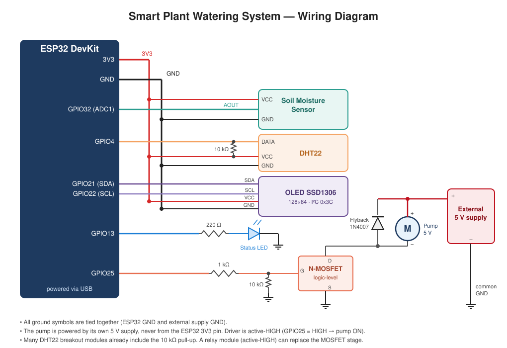

# 🌱 Smart Plant Watering System (ESP32)

An automatic plant irrigation system built on the **ESP32**. It monitors soil moisture and air conditions, waters the plant with a non-blocking *pulse-and-soak* state machine, shows live data and a "plant mood" face on an OLED display, streams readings to the **Blynk** app, and logs history to **Google Sheets**.

Developed as a hands-on project alongside my Automation Engineering studies, to apply signal filtering, finite state machines and connected embedded systems to a real use case.

---

## ✨ Features

- **Soil moisture sensing** with 15× oversampling, EMA filtering and two-point calibration to percentage
- **Air temperature and humidity** from a DHT22, EMA-filtered, with invalid (`NaN`) readings discarded
- **Pulse-and-soak irrigation**: short pump pulses followed by a wait, so the water can spread before the next measurement
- **Non-blocking control** driven by `BlynkTimer` and `millis()`: no long `delay()` calls in the main loop
- **OLED display** (SSD1306 128×64) with readings and a happy / neutral / sad face
- **Status LED** that lights up while the pump is running
- **Blynk IoT dashboard** with soil moisture, temperature, air humidity and pump state
- **Google Sheets logging** through a Google Apps Script Web App

---

## 🔌 Wiring



| Component | Pin | ESP32 |
|---|---|---|
| Soil moisture sensor | AOUT | `GPIO32` (ADC1) |
| DHT22 | DATA | `GPIO4` (10 kΩ pull-up to 3V3) |
| OLED SSD1306 | SDA / SCL | `GPIO21` / `GPIO22` (I²C address `0x3C`) |
| Status LED | anode (via 220 Ω) | `GPIO13` |
| Pump driver | input / gate | `GPIO25` (active-HIGH) |
| Sensors and OLED | VCC / GND | `3V3` / `GND` |

**Power:** the pump runs from a **separate 5 V supply**, with its ground tied to the ESP32 ground. Driving the motor from the same supply as the logic caused voltage drops and resets. A flyback diode across the pump protects the driver from the motor's inductive kick, and a pull-down on the gate keeps the pump off while the ESP32 boots.

> The soil sensor uses an **ADC1** pin on purpose: ADC2 pins cannot be read while Wi-Fi is active.

### Bill of materials

| Component | Notes |
|---|---|
| ESP32 DevKit | Powered via USB |
| Analog soil moisture sensor | Output decreases as moisture increases |
| DHT22 (AM2302) | Air temperature and humidity |
| OLED SSD1306 128×64, I²C | |
| 5 V mini submersible pump | |
| Logic-level N-MOSFET (or active-HIGH relay module) | Pump driver |
| 1N4007 diode, resistors (220 Ω, 1 kΩ, 2× 10 kΩ), LED | |
| External 5 V supply, tubing, water tank | |

---

## 🧠 How It Works

### Main loop and timing

```cpp
void loop() {
  Blynk.run();
  timer.run();
}
```

Two periodic tasks are scheduled with `BlynkTimer`:

| Task | Period | What it does |
|---|---|---|
| `controllaEInviaDati()` | 2 s | Reads sensors, filters, updates Blynk and OLED, runs the pump FSM |
| `salvaStoricoCloud()` | configurable | Sends the latest filtered values to Google Sheets |

The 2 s period matches the minimum sampling interval of the DHT22.

### 1. Signal conditioning

**Soil moisture** goes through three stages:

1. **Oversampling:** 15 ADC readings averaged together. With uncorrelated noise this reduces its standard deviation by about √15 ≈ 3.9×.
2. **EMA filter** (exponential moving average):

   ```
   y[n] = α · x[n] + (1 − α) · y[n−1],    α = 0.15
   ```

   This is a discrete first-order low-pass filter. With a 2 s sampling period, α = 0.15 gives a time constant of

   ```
   τ = −Ts / ln(1 − α) ≈ 12.3 s     (cut-off ≈ 0.013 Hz)
   ```

   Soil moisture changes over minutes, so the extra delay is a fair price for a much smoother signal.
3. **Calibration** to a 0–100 % scale and clamped with `constrain()`:

   ```
   moisture_% = (y − DRY) / (WET − DRY) · 100,    DRY = 3332, WET = 1200
   ```

**Air temperature and humidity** use the same EMA. If the DHT22 returns `NaN`, the sample is skipped and the last filtered value is kept, so a single bad read never corrupts the filter state.

### 2. Pump state machine (pulse-and-soak)

```
              moisture < 30 %
   ┌──────┐  ─────────────────▶  ┌──────────────┐
   │ IDLE │                      │ POMPA_ACCESA │  pump ON, LED ON
   └──────┘                      └──────────────┘
      ▲                                 │ 2 s elapsed
      │                                 ▼
      │   5 s elapsed       ┌─────────────────────────┐
      └──────────────────── │  ATTESA_PROPAGAZIONE    │  pump OFF, wait
                            └─────────────────────────┘
```

| State | Action | Exit condition |
|---|---|---|
| `IDLE` | Pump off, monitor the soil | moisture < `SOGLIA_CRITICA` (30 %) |
| `POMPA_ACCESA` | Pump and LED on, Blynk `V2 = 1` | `TEMPO_POMPA` (2 s) elapsed |
| `ATTESA_PROPAGAZIONE` | Pump off, Blynk `V2 = 0` | `TEMPO_PROPAGAZIONE` (5 s) elapsed |

Water takes time to soak through the soil and reach the sensor. Watering in short pulses and then waiting avoids reacting to a reading that hasn't caught up yet, which would otherwise lead to overwatering. Pulses repeat until moisture rises above the threshold. Transitions are timed with `millis()`, so the display, Blynk and logging keep running while watering.

### 3. OLED display

Shows soil moisture, air temperature and air humidity, plus a face drawn with graphics primitives:

| Soil moisture | Face |
|---|---|
| ≥ 65 % (`SOGLIA_TARGET`) | 😊 happy |
| 30–65 % | 😐 neutral |
| < 30 % (`SOGLIA_CRITICA`) | 😟 sad, watering starts |

### 4. Blynk IoT

| Virtual pin | Data |
|---|---|
| `V1` | Soil moisture (%) |
| `V2` | Pump state (0 / 1) |
| `V3` | Air temperature (°C) |
| `V4` | Air humidity (%) |

### 5. Google Sheets logging

The ESP32 sends an HTTP GET request to a Google Apps Script Web App:

```
<URL_SHEET>?terreno=<soil %>&temp=<°C>&umaria=<air %>
```

Apps Script that appends one row per request:

```javascript
function doGet(e) {
  const sheet = SpreadsheetApp.getActiveSpreadsheet().getActiveSheet();
  sheet.appendRow([
    new Date(),
    e.parameter.terreno,
    e.parameter.temp,
    e.parameter.umaria
  ]);
  return ContentService.createTextOutput("OK");
}
```

Deploy it with *Deploy → New deployment → Web app*, access "Anyone", and paste the URL into `URL_SHEET`. If Wi-Fi is down the upload is simply skipped.

---

## ⚙️ Setup

1. **Libraries** (Arduino IDE or PlatformIO):
   - `Blynk`
   - `DHT sensor library` (Adafruit) and `Adafruit Unified Sensor`
   - `Adafruit SSD1306` and `Adafruit GFX`
   - `WiFi`, `HTTPClient`, `Wire` come with the ESP32 core
2. **Credentials:** fill in the Blynk template ID, template name and auth token, Wi-Fi SSID and password, and the Apps Script URL at the top of `water_plant_sys_v3.ino`. Never commit real credentials; keep them in a `secrets.h` listed in `.gitignore`.
3. **Calibration:** see below.
4. **Upload** to the ESP32 and open the Serial Monitor at **9600 baud**.

### Configuration parameters

| Constant | Default | Meaning |
|---|---|---|
| `VALORE_SECCO` | 3332 | Raw ADC value, sensor dry |
| `VALORE_BAGNATO` | 1200 | Raw ADC value, sensor in water |
| `SOGLIA_CRITICA` | 30 % | Watering starts below this |
| `SOGLIA_TARGET` | 65 % | "Happy plant" threshold |
| `TEMPO_POMPA` | 2000 ms | Duration of each pump pulse |
| `TEMPO_PROPAGAZIONE` | 5000 ms | Wait after each pulse |
| `ALPHA` | 0.15 | EMA coefficient |
| Cloud logging interval | `timer.setInterval(...)` | Recommended: 300000 ms (5 min) |

### Soil sensor calibration

1. Leave the sensor in open air, read the raw ADC value on the serial monitor → `VALORE_SECCO`
2. Put it in water up to the max line, read the raw value → `VALORE_BAGNATO`
3. Write both values in the code and re-upload

A wrong calibration gives out-of-range percentages, which means watering all the time or never.

---

## 🐛 Issues Solved

| Problem | Cause | Fix |
|---|---|---|
| DHT readings returned `NaN` | `DHTTYPE` didn't match the actual sensor | Set `DHTTYPE` to `DHT22`, plus `NaN` handling in code |
| Moisture percentage was wrong | Incorrect calibration value | Re-measured dry and wet points |
| ESP32 reset when the pump started | Pump and logic on the same supply | Separate 5 V supply for the pump, common ground |

---

## 🚀 Future Improvements

- Use `SOGLIA_TARGET` as an upper hysteresis bound, watering until the soil reaches it instead of just above 30 %
- Manual pump button and editable thresholds from the Blynk app
- Water tank level sensor with a low-level alert
- Deep sleep for battery or solar operation
- Multiple plants with independent sensors and valves
- Model-based control tuned on the logged data

---

## 👩‍💻 Author

**Chiara Mancarella** – Automation Engineering student, University of Padova

## 📄 License

MIT License
